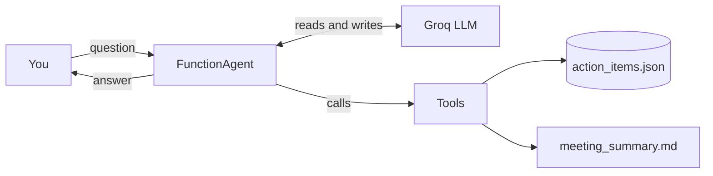

# Meeting Notes Agent

An AI agent that reads meeting notes, writes a short summary, pulls out action items (task, owner, due date), tracks them, and exports a Markdown report. You talk to it in plain English.

Built with LlamaIndex and a free Groq LLM. Dependencies are pinned to the versions the tools were tested with.

## What it can do

- Load a `.txt` or `.md` notes file
- Find dates and deadlines in the text with code (not the model's guess)
- Save action items with owner and due date, list them, filter by owner, mark them done
- Export `outputs/meeting_summary.md` with the summary and a task table
- Remember the conversation for follow-up questions

## How it was built

| Step | Choice |
|---|---|
| 1. Use case | Turn meeting notes into summary and tracked action items |
| 2. LLM and provider | `llama-3.3-70b-versatile` on Groq (free tier, function calling) |
| 3. Tools | `load_notes`, `get_notes`, `find_deadlines`, `add_action_item`, `list_action_items`, `mark_done`, `export_summary` |
| 4. System prompt | `notes_agent/prompts.py` |
| 5. Framework | LlamaIndex `FunctionAgent` |



The agent loops: read your request, pick a tool, read the result, repeat until it can answer.

## Quick start

Python 3.10 or newer.

```bash
git clone https://github.com/dark0danger/meeting-notes-agent.git
cd meeting-notes-agent
python -m venv .venv
source .venv/bin/activate        # Windows: .venv\Scripts\activate
pip install -r requirements.txt
cp .env.example .env             # then paste your free key from console.groq.com
python -m notes_agent.agent
```

Example chat:

```
You: Analyse samples/team_meeting.md and save the action items
You: What does Omar need to do?
You: Omar finished the login bug
You: Export the summary with title Weekly product sync
```

## Test the tools (no API key needed)

```bash
pytest
```

## Project layout

```
notes_agent/agent.py     agent and chat loop
notes_agent/tools.py     the tools
notes_agent/prompts.py   system prompt
samples/                 example notes
tests/                   tool tests
```

## Limits

The model can misread vague notes. Check owners and dates before relying on them. Action items are stored in a local JSON file.

## License

MIT
